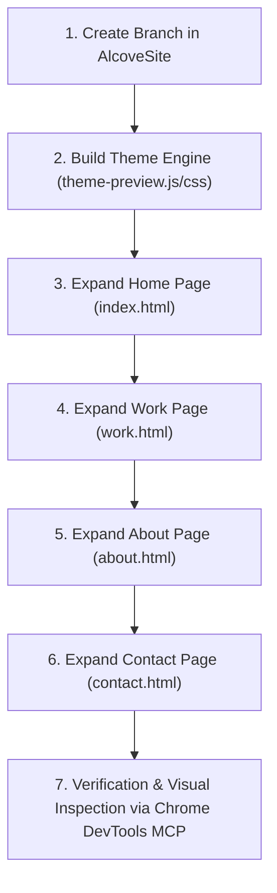

# Plan: Alcove Recording — Theme Presets & Content Expansion

**Target Repository**: [`/Users/alex/Downloads/AlcoveSite`](file:///Users/alex/Downloads/AlcoveSite)  
**Client**: Seth Miller (Music Producer), Alcove Recording Studio  
**Target Audience**: Teens, high school musicians, and first-time recording artists  
**Core Tone**: Welcoming, unintimidating, creative, and inspiring  

---

## 1. Branching Strategy
- Branch from `main`: `feature/theme-options-and-content-expansion`.
- Run all work in `/Users/alex/Downloads/AlcoveSite`.
- Gate with `.agents/PLAN_LOCK` to ensure alignment before file edits.

---

## 2. Design Preview Toolbar & Theme Presets

### Architecture
- **Zero-Dependency Shared Engine**: A lightweight vanilla script (`theme-preview.js`) and CSS (`theme-preview.css`) included in the global `<head>` of all 4 pages.
- **Cross-Page Synchronization**: Stores the active palette and font choice in `localStorage` so the selected theme persists when clicking between `Home`, `Work`, `About`, and `Contact`.
- **Accessible UI (`role="toolbar"`)**: Floating pill dock in the bottom-right corner (`[ 🎨 THEMES ]`) that expands into a clean, accessible control panel with `aria-pressed` states and single tab-stop keyboard navigation.
- **One-Click Export**: A `[ 📋 Copy Active CSS ]` button that copies the exact `:root { ... }` block to the clipboard, allowing Seth to immediately finalize his preferred palette as the permanent site default.

### Curated Color Palettes (Indie, Creative & Welcoming)
1. **Warm Analog Studio (Recommended / Default)**:
   - `--bg-page`: `#FAF6EE` (Warm linen cream)
   - `--bg-surface`: `#FFFFFF` (Crisp paper white)
   - `--bg-accent`: `#F0EAE1` (Soft oat parchment)
   - `--text-main`: `#1C1814` (Deep warm espresso)
   - `--text-muted`: `#6B635B` (Muted walnut)
   - `--accent-primary`: `#D97706` (Warm vintage amber / brass)
   - `--border-color`: `#E5DCD0`
   - *Vibe*: Real acoustic wood baffles, warm tube gear, cozy studio sanctuary.

2. **Indie Cassette / Velvet Sunset**:
   - `--bg-page`: `#13111C` (Deep velvet dusk)
   - `--bg-surface`: `#1C1929` (Rich dark slate)
   - `--bg-accent`: `#262238`
   - `--text-main`: `#F5EFEB` (Soft linen)
   - `--text-muted`: `#9E97B0` (Dusty lilac)
   - `--accent-primary`: `#E05A47` (Terracotta coral)
   - `--border-color`: `#302B45`
   - *Vibe*: Bedroom pop, indie rock, DIY tape saturation, late-night creative flow.

3. **Golden Hour Tracking Room**:
   - `--bg-page`: `#FDFBF7` (Morning sunlight white)
   - `--bg-surface`: `#FFFFFF`
   - `--bg-accent`: `#F4EFE6`
   - `--text-main`: `#242E20` (Forest olive dark)
   - `--text-muted`: `#5D6B57`
   - `--accent-primary`: `#4D7C5F` (Studio sage green & warm ochre `#E59838`)
   - `--border-color`: `#E0DACF`
   - *Vibe*: Natural light streaming into the live room, acoustic guitars, calm and relaxed.

4. **Midnight Console / Blue Hour**:
   - `--bg-page`: `#0D131C` (Studio midnight navy)
   - `--bg-surface`: `#151E2B` (Rack gear dark surface)
   - `--bg-accent`: `#1D2A3C`
   - `--text-main`: `#EDF3F8` (Crisp bright paper)
   - `--text-muted`: `#8496AA`
   - `--accent-primary`: `#F59E0B` (Glowing console meter amber)
   - `--border-color`: `#243348`
   - *Vibe*: Mixing at the desk with subtle console meter backlights, modern indie/electronic hybrid.

### Typography Pairings (Loaded via Google Fonts)
1. **Warm Editorial Grotesk**: `Plus Jakarta Sans` / `Outfit` (Headings) + `Inter` (Body) + `JetBrains Mono` (Track info/times).
2. **Indie Album Liner**: `Space Grotesk` (Headings) + `Inter` (Body) + `Space Mono` (Accents).
3. **Friendly Modernist**: `Outfit` (Headings) + `Plus Jakarta Sans` (Body) + `JetBrains Mono`.

---

## 3. Comprehensive Content Expansion (All 4 Pages)

> **STRICT COPYWRITING RULE**: All editorial narratives, marketing descriptions, testimonials, and bio details will strictly use clean, structured placeholder text (`[ ... ]`) for Seth Miller to author himself.

### A. Home (`index.html`)
- **First Time in a Studio? 3-Step Journey**:
  - Step 1: `[ Voice Memo to Demo ]` — bring rough bedroom recordings or simple phone audio.
  - Step 2: `[ Comfortable Tracking ]` — zero pressure, take your time, get the take you love.
  - Step 3: `[ The Finished Master ]` — mixed, balanced, and ready for Spotify & Apple Music.
- **What We Record (Genre Showcase Cards)**:
  - Indie Rock & Alternative Bands (`[ Live drums, guitar amps, vocal energy ]`).
  - Singer-Songwriters & Acoustic (`[ Rich vocal clarity, intimate acoustic tone ]`).
  - Bedroom Pop & Electronic (`[ Synthesizers, vocal tuning, beat mixing ]`).
  - Rap, Hip-Hop & Vocals (`[ Clean punchy lead vocals, ad-libs, master polish ]`).
- **Studio Gear Highlights (Accessible, Not Jargon-Heavy)**:
  - High-end vocal microphones, treated acoustic room, comfortable monitoring headphones, real amplifiers.

### B. Examples & Work (`work.html`)
- **Audio Demos Interactive Player**:
  - Track list with duration badges (`2:45`, `3:12`, etc.), genre filter buttons (`[ All ]`, `[ Indie ]`, `[ Pop ]`, `[ Rock ]`), play/pause state toggle, and simulated progress scrubber.
- **Before & After Evolution Cards**:
  - "The Voice Memo" (rough iPhone capture snippet) vs "The Studio Master" (fully produced track).
- **Session Photo Gallery Grid**:
  - 6 styled 4:3 photo frame slots with captions (`[ Photo: Vocal tracking in the vocal booth ]`, `[ Photo: Mixing on the console ]`, `[ Photo: Drum setup ]`).

### C. About Seth Miller (`about.html`)
- **Producer Philosophy Cards**:
  - "Mentorship Over Gatekeeping" (`[ Encouraging young musicians to find their sound ]`).
  - "The Creative Safe Space" (`[ Making mistakes is part of writing great songs ]`).
  - "Affordable & Fair for Student Artists" (`[ Clear pricing with no surprise studio fees ]`).
- **Interactive First-Timer FAQ**:
  - Built with accessible native `
` / `
` accordions:
    - *Do I have to be completely rehearsed before coming in?*
    - *Can my friends or parents hang out during the session?*
    - *What should I bring on tracking day?*
    - *How long does it take to get the final mix?*

### D. Contact & Session Booking (`contact.html`)
- **Friendly, Low-Pressure Inquiry Form**:
  - Artist / Band Name (`[ Enter your name or band ]`).
  - First-Time Recording? (`[ Yes, first time! ]` / `[ I've recorded before ]` interactive toggle).
  - Project Scope (`[ Single Song ]`, `[ EP / 3-5 Songs ]`, `[ Just Vocals ]`, `[ Full Album ]`).
  - Sound Inspiration / Link (`[ Paste a Spotify, YouTube, or Voice Memo link ]`).
  - Preferred Dates & Questions (`[ Tell Seth what you want to achieve ]`).
- **What Happens Next Roadmap**:
  - Step 1: Seth listens to your ideas and texts/emails you back within 24–48 hours.
  - Step 2: Quick, casual pre-production call to plan the session.
  - Step 3: Lock in your session date at Alcove Recording.

---

## 4. Implementation Sequence

1. **Phase 1: Setup & Branching**: Check out `feature/theme-options-and-content-expansion` in `/Users/alex/Downloads/AlcoveSite`.
2. **Phase 2: Theme Engine**: Implement `theme-preview.js` and `theme-preview.css` with 4 warm/indie palettes, 3 font pairings, `localStorage` persistence, and the Copy CSS utility. Include across all 4 pages.
3. **Phase 3: Content Expansion**: Update `index.html`, `work.html`, `about.html`, and `contact.html` with the new sections and placeholders in micro-batched slices (<150 lines per turn).
4. **Phase 4: Responsive & Visual Verification**: Test mobile & desktop viewports, verify contrast ratios, and take screenshots for visual confirmation.
